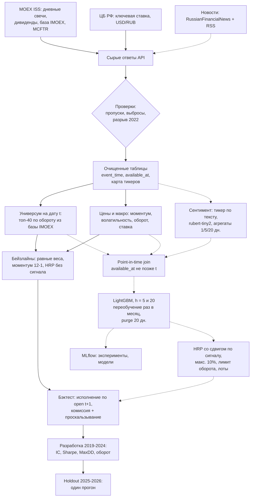
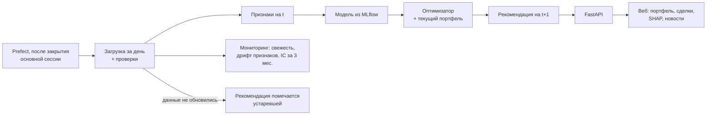

# ML System Design Doc: MOEX Portfolio Copilot (MVP, итерация 1)

Статус: черновик к ДЗ-1. Разделы 1, 2.1 и 2.2 заполнены, 2.3 и дальше будут после EDA. Часть цифр пока предварительная, такие места помечены "проверить".

## 1. Цели и предпосылки

### 1.1. Зачем идем в разработку продукта?

**Бизнес-цель.** Пользователь — частный инвестор с брокерским счетом или ИИС, у которого 10-20 российских акций (цифры условные, ориентируюсь на типичный счет). Раз в месяц он пересобирает портфель вручную: графики, новости, Telegram-каналы, веса в Excel. На это уходит пара часов, и решения часто принимаются по настроению: докупить то, что выросло на прошлой неделе, держать упавшее, пока не отрастет.

Сервис раз в день собирает данные по ликвидным акциям Мосбиржи, оценивает бумаги на горизонтах неделя и месяц и предлагает целевой портфель со списком сделок, комиссиями и объяснением.

**Почему с ML должно быть лучше.** Обыграть индекс на публичных данных я не рассчитываю. ML здесь нужен для другого. Признаки по 40 бумагам, ставке и новостям каждый день считаются одним и тем же кодом. Новости превращаются в число по каждому тикеру, вместо ленты, которую надо читать. Риск задается явными ограничениями (вес бумаги, волатильность, оборот), и у каждой рекомендации есть объяснение, которое можно проверить.

**Что считаю успехом итерации.** Тут два уровня.
1. Технический (обязательный): работает пайплайн от загрузки данных до предложенного портфеля, есть walk-forward бэктест без утечек, результат сравнивается с тремя бейзлайнами и индексом MCFTR. Если ML после комиссий не обгонит равновесный портфель, это тоже результат: значит, на этих данных сигнала нет, и я это покажу цифрами.
2. Продуктовый: критерии успеха пилота из 1.2. Если они не выполнены, проект идет в запасной вариант (см. конец 1.2).

Бизнес-метрика для пользователя: время на ежемесячную пересборку портфеля сокращается с 2-3 часов до 15-20 минут (посмотреть рекомендацию и решить, какие сделки делать).

### 1.2. Бизнес-требования и ограничения

**Бизнес-требования**
1. Рекомендация готова каждый торговый день до 8:30 МСК, то есть до начала основной сессии (с 14.09.2026 она начинается в 9:00). Строится только на данных, известных к закрытию основной сессии предыдущего дня.
2. Пользователь видит текущий и целевой портфель, список сделок с учетом лотов и оценку комиссий.
3. Для каждой бумаги в рекомендации есть объяснение: какие признаки сильнее всего повлияли на оценку и какие новости за последние дни учтены.
4. Портфель только long, без плеча и шортов. Большинство частных инвесторов так и торгуют, а для MVP это сильно упрощает модель риска.
5. Пользователь может задать ограничения: максимальный вес бумаги (по умолчанию 10%), оборот за ребалансировку (по умолчанию не больше 30% портфеля), исключенные бумаги.
6. Любой прогон бэктеста воспроизводится по версии кода и дате среза данных.

**Ограничения**
- Делаю один, примерно 12 недель (конец октября - середина января), параллельно с работой и учебой.
- Бюджет на данные и инфраструктуру нулевой. Источники: MOEX ISS, API ЦБ, открытые новостные датасеты, RSS. Всё доступно из России без VPN.
- Бесплатные данные ISS идут с задержкой 15 минут, поэтому внутридневная торговля вообще не рассматривается.
- Это не индивидуальная инвестиционная рекомендация, в интерфейсе и README будет дисклеймер. Сырые данные биржи в публичный репозиторий не кладу: бесплатно ISS дает данные для ознакомления, распространение идет по договору с биржей. В репозитории только скрипты загрузки.
- Всё запускается на ноутбуке и дешевом VPS, без GPU в проде. GPU нужен один раз, для дообучения модели сентимента.

**Что ожидаю от итерации.** Данные за 2015-2026 лежат в point-in-time хранилище, есть бэктест-движок с комиссиями и бейзлайнами. Модель ранжирования обучена на ценовых, макро- и новостных признаках, портфель собирает оптимизатор. Есть простой веб-интерфейс и мониторинг свежести данных и качества сигнала.

**Как система используется (сценарий пилота).** Вечером по расписанию загружаются свечи и новости, пересчитываются признаки и рекомендация. Утром пользователь открывает дашборд и видит предложенную ребалансировку. Сделки он делает сам у своего брокера, сервис никуда ничего не отправляет. Как часто ребалансироваться, раз в неделю или раз в месяц, выбирает пользователь.

Пилот на реальных деньгах в рамках курса не делаю. Вместо него paper trading с 10-й недели до защиты, это примерно 2-3 недели (часть из них новогодние праздники). Каждый день записываю рекомендацию и потом смотрю, что было. За такой срок качество сигнала не измерить, поэтому в пилоте проверяются только эксплуатационные вещи, а качество сигнала оценивается на holdout-периоде.

**Критерии успеха пилота**

Эксплуатация (paper trading):
- нет пропущенных торговых дней
- нет дней, когда рекомендация построена на устаревших данных, без пометки об этом

Качество сигнала (бэктест, горизонт 20 дней, IC по датам без перекрытия):
- на периоде разработки (2019-2024) средний IC ≥ 0,03, t-статистика с поправкой Newey-West ≥ 2
- на holdout (01.2025-10.2026) знак IC тот же, а значение не меньше половины IC на периоде разработки. Нижнюю границу бутстрэп-интервала (блоки по 20 дней) тоже покажу, но порогом ее не делаю: на 40 бумагах и ~20 месячных точках интервал будет широким

Портфель (holdout, после издержек):
- годовой Sharpe не ниже Sharpe равновесного портфеля минус 0,1
- максимальная просадка меньше, чем у MCFTR за тот же период

Если критерии выполнены, дальше можно добавить облигации, налоговую логику (ИИС, ЛДВ) и Black-Litterman. Если нет, проект сужается до ребалансировщика на основе риска, без прогноза доходностей. Волатильность хотя бы кластеризуется и прогнозируется заметно лучше доходности, так что рабочий результат будет в любом случае.

### 1.3. Что входит в скоуп проекта/итерации, что не входит

**Входит**
- 40 самых ликвидных бумаг Мосбиржи (акции и депозитарные расписки). Универсум на дату t: бумаги из базы расчета индекса IMOEX на эту дату, из них топ-40 по медианному обороту за 60 дней. Если в базе меньше 40 бумаг, берем все.
- Дневные данные, горизонты прогноза 5 и 20 торговых дней.
- Признаки: ценовые (моментум, волатильность, ликвидность), макро (ключевая ставка, курс рубля), новостной сентимент по тикерам.
- Модель ранжирования, оптимизатор портфеля, walk-forward бэктест.
- Batch-инференс раз в день, FastAPI, веб-интерфейс.
- Мониторинг: свежесть данных, дрифт признаков, скользящий IC.

**Не входит**
- Реальная торговля и интеграция с брокерскими API.
- Облигации, фонды, фьючерсы, валюта, крипта.
- Внутридневные стратегии и всё, что требует real-time данных.
- Налоги, дивидендная стратегия, риск-профиль по анкете.
- Фундаментальные признаки из отчетности. Для 40 эмитентов их пришлось бы собирать с e-disclosure почти вручную, откладываю на следующую итерацию.

**Качество кода и воспроизводимость.** Python-пакет с тестами, Docker Compose, эксперименты в MLflow. Команда `make reproduce` прогоняет бэктест с нуля на зафиксированном срезе данных. В CI есть отдельный тест: ни один признак на дату t не использует запись с `available_at > t`.

**Технический долг, который оставляю сознательно.** Оркестрация на Prefect без отказоустойчивости, DuckDB + Parquet вместо отдельной БД, без авторизации и многопользовательского режима. Проскальзывание задано константой, без моделирования по стакану. Модель сентимента дообучу один раз и по расписанию переобучать не буду.

### 1.4. Предпосылки решения

**Рынок.** Мосбиржа: все нужные данные бесплатные и доступны из России, загрузку может повторить любой. 40 бумаг взял на глаз: в топ-40 по обороту бумаги торгуются каждый день, а дальше начинается второй эшелон с широкими спредами и днями без сделок. После EDA число может поменяться.

**Тикеры.** В истории индекса есть бумаги, которые меняли тикер после редомициляции (YNDX → YDEX, TCSG → T, FIVE → X5). Нужна таблица соответствия, иначе история таких бумаг рвется. Делистинговые бумаги остаются в бэктесте до даты делистинга (survivorship bias).

**История 2015-2026.** С 28 февраля по 23 марта 2022 торгов акциями не было. 24 марта открыли 33 бумаги из индекса в сокращенную сессию, остальные 28 марта, шорты были запрещены. Режим рынка после этого другой: нерезиденты ушли, часть бумаг делистинговали. Данные за этот период оставляю, но:
- доходность через разрыв (25.02 → 24.03) не идет в оценку ковариации и в таргеты, эти даты помечаются отдельно
- метрики считаю отдельно до и после 2022

**Гранулярность.** Один день по одной бумаге. Внутридневные данные (если получится бесплатный доступ к ALGOPACK, надо проверить условия) использую только как дневные агрегаты, например дисбаланс покупок и продаж за день.

**Горизонты.** 5 и 20 торговых дней, по задаче "подсказки на разные сроки". Под каждый горизонт отдельная модель и своя частота ребалансировки: h = 5 для еженедельной, h = 20 для ежемесячной. В интерфейсе по умолчанию ежемесячная. Год и больше не прогнозирую, для длинного горизонта разумнее аллокация по риску без прогноза доходности.

**Цены и исполнение.** Сигнал строится по цене закрытия основной сессии дня t (LEGALCLOSEPRICE в ISS). Исполнение в бэктесте по цене открытия дня t+1, от нее же считается таргет. Доходность полная, с дивидендами по дате отсечки, иначе сравнение с MCFTR некорректно. Бенчмарк MCFTR, дополнительно MCFTRR (версия с налогом на дивиденды, ближе к тому, что реально получает частный инвестор).

**Point-in-time.** У каждой записи два времени: `event_time` (к какому моменту относится) и `available_at` (когда стало известно). Новость, вышедшая после закрытия основной сессии, относится к следующему торговому дню. Расписание сессий хранится по датам, потому что оно менялось (в том числе 14.09.2026).

**Частота пересчета.** Признаки и сигналы обновляются каждый день, модель переобучается раз в месяц на расширяющемся окне.

**Данные**
| Блок | Источник | Комментарий |
|---|---|---|
| Цены, объемы, состав IMOEX, MCFTR | MOEX ISS | бесплатно, без ключа |
| Ключевая ставка, USD/RUB | ЦБ РФ (XML/SOAP) | бесплатно |
| История новостей | RussianFinancialNews (HF/Kaggle, ~92 тыс. статей) | проверить, какие годы покрыты |
| Свежие новости | RSS Интерфакс, РБК, Финам | источники не совпадают с датасетом, см. 2.3 |
| Разметка сентимента | FiNeS + ручная доразметка | проверить период |
| Резерв для цен | T-Invest API | нужен счет в Т-Банке, только для меня |

**Модель сентимента и утечки.** rubert-tiny2 дообучается на размеченных заголовках (не на доходностях). Признак сентимента используется только для дат после периода, на котором обучалась модель. Если разметка пересекается с периодом бэктеста, это надо будет учесть, проверю на EDA.

**Издержки.** 0,05% комиссии плюс 0,05% проскальзывания на каждую сторону. Комиссия примерно как у брокерских тарифов, проскальзывание пока взято грубо, позже уточню по спредам. Размер счета для пересчета в лоты: 1 млн ₽.

## 2. Методология

### 2.1. Постановка задачи

Это две задачи, которые решаются последовательно: ранжирование бумаг и оптимизация портфеля.

**1. Ранжирование бумаг по поперечному срезу.** На каждую дату t модель выдает оценку s(i, t) для каждой бумаги i из универсума. Таргет — ранг будущей полной доходности бумаги внутри даты:

```
R(i, t, h) = P_open(i, t+1+h) / P_open(i, t+1) - 1   (с дивидендами)
y(i, t, h) = rank-gauss( R(i, t, h) ) по бумагам на дату t,   h in {5, 20}
```

Вычитать доходность индекса для ранжирования смысла нет: внутри даты из всех бумаг вычитается одно и то же число, и порядок не меняется. Избыточная доходность к MCFTR нужна только в отчетах.

Для портфеля нужен порядок бумаг, точное значение доходности не используется. Поэтому основная метрика — IC: корреляция Спирмена между s и R по бумагам на дату, усредненная по датам.

Модели:
- основная: LightGBM-регрессия на y, ранняя остановка по IC на валидации
- для сравнения: LightGBM lambdarank (линейный `label_gain`, `lambdarank_truncation_level=40`). По умолчанию NDCG смотрит в основном на верх списка, а мне важен весь порядок, поэтому это вторичный вариант

Обучающие даты беру раз в 5 дней. При ежедневных датах и h = 20 соседние группы почти повторяют друг друга, и эффективная выборка — всего несколько десятков месяцев.

**2. Оптимизация портфеля.** На входе оценки s, ковариация доходностей за 252 торговых дня (shrinkage Ledoit-Wolf), текущий портфель и ограничения пользователя. На выходе целевые веса и список сделок.

Основной метод — HRP, веса которого сдвигаются в сторону бумаг с высоким s:

```
w_i = w_HRP_i * exp(k * z_i),   z_i = z-score(s_i) на дату
```

Дальше нормировка, ограничение 10% на бумагу, ограничение оборота и округление до лотов. Параметр k подбирается на периоде разработки. Для сравнения mean-variance со штрафом за оборот.

**Бейзлайны** (сигнал от модели не используют):
1. Равновесный портфель из всех бумаг универсума, ребалансировка раз в месяц.
2. Моментум 12-1: топ-10 по доходности за 12 месяцев без последнего, равные веса.
3. HRP без сигнала, только риск.

**Схема оценки.** Walk-forward на 2019-2024 (период разработки): расширяющееся окно, переобучение раз в месяц, purge 20 дней в конце train (их таргеты заходят в test). Holdout 01.2025-10.2026 прогоняется один раз на 11-й неделе с замороженной конфигурацией. Количество опробованных конфигураций логирую в MLflow.

**Метрики**
- Сигнал: IC и ICIR (средний IC, деленный на его стандартное отклонение), разница доходности верхнего и нижнего квинтиля.
- Портфель после издержек: доходность, Sharpe (безрисковая ставка — ключевая ставка ЦБ), максимальная просадка, оборот, tracking error к MCFTR.
- Система: время от закрытия торгов до готовой рекомендации, доля успешных ежедневных прогонов.

### 2.2. Блок-схема решения

Схема предварительная, уточню после EDA. Разбил на две части: offline (данные → обучение → бэктест) и online (ежедневный прогон). Пунктиром отмечено то, что есть только в MVP, сплошные линии общие с бейзлайном.

**Offline: данные, обучение, оценка**



**Online: ежедневный прогон**



**План по неделям**

| Неделя | Что делаю | Результат |
|---|---|---|
| 1-3 | Загрузка ISS и ЦБ, хранилище, проверки качества, карта тикеров, EDA новостного датасета | Очищенные данные 2015-2026 |
| 4 | Бэктест-движок, три бейзлайна | Первые кривые доходности |
| 5-6 | Признаки, тест на утечки, LightGBM, сентимент, абляция с новостями и без | Отчет по IC |
| 7 | Оптимизатор с ограничениями | Сравнение HRP и mean-variance |
| 8-9 | MLflow, ежедневный пайплайн, FastAPI, интерфейс | Рабочий сервис |
| 10 | Мониторинг, старт paper trading, разбор техдолга | Пилот запущен |
| 11 | Прогон на holdout, статистика | Итоговые метрики |
| 12 | Документация, демо, запас по времени | Защита |

### 2.3. Этапы решения задачи

Заполню после EDA. Что проверить в первую очередь:
- сколько бумаг из базы IMOEX за 2015-2026 есть в ISS целиком, сколько делистинговано и сколько меняли тикер
- какой период покрывает RussianFinancialNews. Если не весь 2015-2026, абляцию с новостями делаю только на этом подпериоде
- как часто в новостях упоминаются компании из универсума. Если у половины бумаг меньше одной новости в неделю, сентимент для них бесполезен
- насколько различаются RSS-новости и новости из датасета (источники разные, это сдвиг между обучением и продом)
- насколько отличаются распределения признаков до и после 2022
- когда ISS обновляет `/history` после закрытия, от этого зависит время ежедневного прогона

## 3. Риски

| Риск | Что делаю |
|---|---|
| Сигнал не обгоняет равновесный портфель | Это заложено в критерии. Запасной вариант — ребалансировщик на прогнозе риска |
| Утечка будущего в признаки | `available_at` у каждой записи, тест в CI, purge перед test |
| Survivorship bias | Универсум по исторической базе индекса, делистинговые бумаги остаются |
| Подгонка под holdout | Holdout прогоняется один раз, число конфигураций логируется |
| ISS меняет формат или ограничивает частоту запросов | Кэш сырых ответов, ретраи с паузой, резерв T-Invest API |
| Мало новостей по второму эшелону | Отдельный признак "нет новостей", чтобы отсутствие не путалось с нейтральным сентиментом |

## Ссылки

- [Шаблон ML System Design Doc от Reliable ML](https://github.com/IrinaGoloshchapova/ml_system_design_doc_ru)
- [MOEX ISS](https://www.moex.com/a2193)
- [Индексы полной доходности MCFTR, MCFTRR](https://www.moex.com/s2548)
- [Расписание торгов с 14.09.2026](https://www.moex.com/n103379)
- [RussianFinancialNews на Hugging Face](https://huggingface.co/datasets/Kasymkhan/RussianFinancialNews)
- López de Prado, *Advances in Financial Machine Learning*: purged cross-validation, HRP
