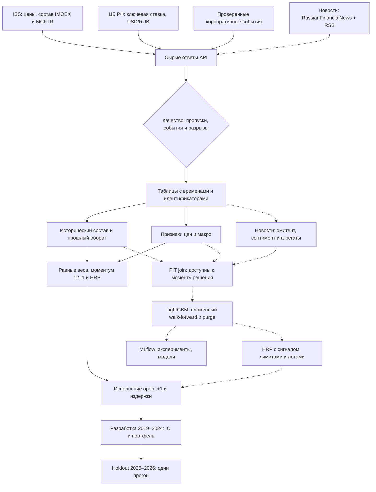
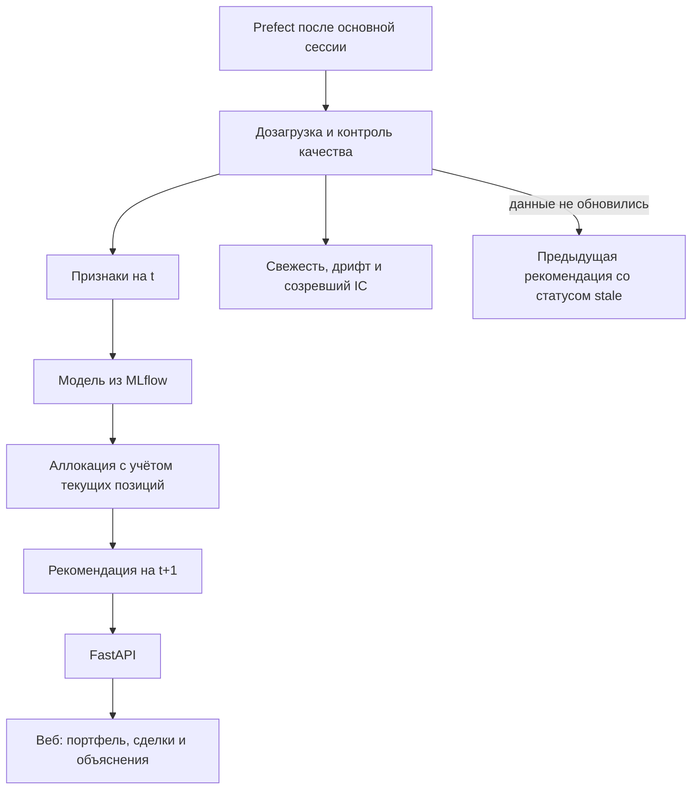

# ML System Design Doc: MOEX Portfolio Copilot (MVP, итерация 1)

Статус: ДЗ-2 — EDA и проектирование этапов решения. Измеренные результаты и ограничения среза данных находятся в [отчёте EDA](../reports/eda/README.md), численные сводки — в `reports/eda/summary.json`. Модели, бэктест, оптимизатор и сервис пока запланированы; их результаты ниже не заявляются. Пороговые бизнес-критерии остаются гипотезами для проверки.

## 1. Цели и предпосылки

### 1.1. Зачем идем в разработку продукта?

**Бизнес-цель.** Пользователь — частный инвестор с брокерским счетом или ИИС, у которого 10-20 российских акций (цифры условные, ориентируюсь на типичный счет). Раз в месяц он пересобирает портфель вручную: графики, новости, Telegram-каналы, веса в Excel. На это уходит пара часов, и решения часто принимаются по настроению: докупить то, что выросло на прошлой неделе, держать упавшее, пока не отрастет.

Сервис раз в день собирает данные по ликвидным акциям Мосбиржи, оценивает бумаги на горизонтах неделя и месяц и предлагает целевой портфель со списком сделок, комиссиями и объяснением.

**Почему проверяем ML.** Преимущество по доходности на публичных данных не предполагается заранее. Пайплайн должен одинаково считать признаки и ограничения каждый день; это полезно и без обучаемого прогноза. Гипотеза ML-ветки — комбинация ценовых и при наличии пригодных данных новостных признаков улучшает относительный порядок бумаг. Её вклад проверяется против простых правил после издержек. Автоматизация расчёта сама по себе не доказывает необходимость ML.

**Что считаю успехом итерации.** Тут два уровня.
1. Технический (обязательный): работает пайплайн от загрузки данных до предложенного портфеля, есть walk-forward бэктест без утечек, результат сравнивается с тремя бейзлайнами и индексом MCFTR. Если ML после комиссий не обгонит равновесный портфель, это тоже результат: преимущество выбранного решения на проверенном периоде не подтверждено. Это не доказывает отсутствие любого возможного сигнала.
2. Продуктовый: критерии успеха пилота из 1.2. Если они не выполнены, проект идет в запасной вариант (см. конец 1.2).

Бизнес-метрика для пользователя: время на ежемесячную пересборку портфеля сокращается с 2-3 часов до 15-20 минут (посмотреть рекомендацию и решить, какие сделки делать).

### 1.2. Бизнес-требования и ограничения

**Бизнес-требования**
1. Рекомендация готова каждый торговый день до 8:30 МСК. Рыночный cutoff — закрытие основной сессии предыдущего дня; точное расписание хранится по датам и проверяется перед пилотом. Используются только сведения, относящиеся к этому cutoff и поступившие до фактического времени расчёта. Поздние новости и исправления данных не добавляются задним числом.
2. Пользователь видит текущий и целевой портфель, список сделок с учетом лотов и оценку комиссий.
3. Для каждой бумаги в рекомендации есть объяснение: какие признаки сильнее всего повлияли на оценку и какие новости за последние дни учтены.
4. Портфель только long, без плеча и шортов. Большинство частных инвесторов так и торгуют, а для MVP это сильно упрощает модель риска.
5. Пользователь может задать ограничения: максимальный вес бумаги (по умолчанию 10%), оборот за ребалансировку (по умолчанию не больше 30% портфеля), исключенные бумаги.
6. Любой прогон бэктеста воспроизводится по версии кода и дате среза данных.

**Ограничения**
- Делаю один, примерно 12 недель (конец октября - середина января), параллельно с работой и учебой.
- Бюджет на платные данные нулевой. Основные источники: MOEX ISS, API ЦБ, открытые новостные датасеты, RSS. Доступность проверяется загрузчиком; возможность бесплатного восстановления всех исторических сущностей пока не подтверждена.
- Внутридневная торговля не рассматривается. Задержку и момент окончательной публикации дневных данных ISS ещё нужно измерить для выбранных полей; доступность API не означает готовность завершённой сессии.
- Это не индивидуальная инвестиционная рекомендация, в интерфейсе и README будет дисклеймер. Сырые данные биржи в публичный репозиторий не кладу: бесплатно ISS дает данные для ознакомления, распространение идет по договору с биржей. В репозитории публикуются скрипты и агрегированные результаты EDA.
- Всё запускается на ноутбуке и дешевом VPS, без GPU в проде. GPU нужен один раз, для дообучения модели сентимента.

**Что ожидаю к завершению семестровой итерации.** Проверенные данные 2015–2026, бэктест с комиссиями и бейзлайнами, модель ранжирования и ограниченная портфельная аллокация, простой интерфейс и мониторинг. Новости включаются при подтверждённой пригодности; иначе сохраняется ценовой вариант. Эти компоненты — целевое состояние, а не текущая реализация ДЗ-2.

**Как система используется (сценарий пилота).** Вечером по расписанию загружаются свечи и новости, пересчитываются признаки и рекомендация. Утром пользователь открывает дашборд и видит предложенную ребалансировку. Сделки он делает сам у своего брокера, сервис никуда ничего не отправляет. Как часто ребалансироваться, раз в неделю или раз в месяц, выбирает пользователь.

Пилот на реальных деньгах в рамках курса не делаю. Вместо него paper trading с 10-й недели до защиты, это примерно 2-3 недели (часть из них новогодние праздники). Каждый день записываю рекомендацию и потом смотрю, что было. За такой срок качество сигнала не измерить, поэтому в пилоте проверяются только эксплуатационные вещи, а качество сигнала оценивается на holdout-периоде.

**Критерии успеха пилота**

Эксплуатация (paper trading):
- нет пропущенных торговых дней
- нет дней, когда рекомендация построена на устаревших данных, без пометки об этом

Качество сигнала (бэктест, горизонт 20 дней, IC по датам без перекрытия):
- на периоде разработки (2019-2024) средний IC ≥ 0,03, t-статистика с поправкой Newey-West ≥ 2
- на holdout (01.2025-10.2026) знак IC тот же, а значение не меньше половины IC на периоде разработки. Нижняя граница bootstrap-интервала также показывается, но не служит порогом: на небольшом числе неперекрывающихся точек интервал будет широким. Длина блока задаётся в последовательных точках IC, а не смешивается с 20 торговыми днями; чувствительность к длине блока входит в отчёт

Портфель (holdout, после издержек):
- годовой Sharpe не ниже Sharpe равновесного портфеля минус 0,1
- максимальная просадка меньше, чем у MCFTR за тот же период

Если критерии выполнены, дальше можно добавить облигации, налоговую логику (ИИС, ЛДВ) и Black-Litterman. Если нет, проект сужается до ребалансировщика на основе риска, без прогноза доходностей. Для запасного варианта тоже потребуется проверка качества оценки риска и исполнимости ограничений; полезность заранее не гарантирована.

### 1.3. Что входит в скоуп проекта/итерации, что не входит

**Входит**
- 40 самых ликвидных бумаг Мосбиржи (акции и депозитарные расписки). Универсум на дату t: бумаги из базы расчета индекса IMOEX на эту дату, из них топ-40 по медианному обороту за 60 дней. Если в базе меньше 40 бумаг, берем все.
- Дневные данные, горизонты прогноза 5 и 20 торговых дней.
- Признаки: ценовые (моментум, волатильность, ликвидность), макро (ключевая ставка, курс рубля), новостной сентимент по тикерам.
- Модель ранжирования, оптимизатор портфеля, walk-forward бэктест.
- Batch-инференс раз в день, FastAPI, веб-интерфейс.
- Мониторинг: свежесть данных, дрифт признаков, скользящий IC.

**Не входит**
- Реальная торговля и интеграция с брокерскими API.
- Облигации, фонды, фьючерсы, валюта, крипта.
- Внутридневные стратегии и всё, что требует real-time данных.
- Налоги, дивидендная стратегия, риск-профиль по анкете.
- Фундаментальные признаки из отчетности. Для 40 эмитентов их пришлось бы собирать с e-disclosure почти вручную, откладываю на следующую итерацию.

**Качество кода и воспроизводимость.** Для ДЗ-2 нужны загрузчик, локальный кэш, EDA и изолированные тесты. Целевая реализация включает Python-пакет, Docker Compose, MLflow и команду `make reproduce` для полного бэктеста. Эти компоненты не считаются готовыми в ДЗ-2. Будущий PIT-тест проверяет, что каждый вход признака доступен к моменту решения; один лишь тест формата timestamps этого не доказывает.

**Технический долг, который оставляю сознательно.** Оркестрация на Prefect без отказоустойчивости, DuckDB + Parquet вместо отдельной БД, без авторизации и многопользовательского режима. Проскальзывание задано константой, без моделирования по стакану. Модель сентимента дообучу один раз и по расписанию переобучать не буду.

### 1.4. Предпосылки решения

**Рынок.** Ликвидные акции Мосбиржи; целевой максимум — 40 бумаг на дату. Это проектный параметр, а не доказанная граница ликвидности. EDA проверяет покрытие, обороты и короткие истории. Квартальные срезы IMOEX дают исследовательский список тикеров; они не восстанавливают точные даты входа и выхода из индекса и сами по себе не устраняют survivorship bias.

**Тикеры.** Пары YNDX/YDEX, TCSG/T, FIVE/X5 — кандидаты для проверки корпоративных событий, а не правила автоматической склейки. Нужны устойчивый идентификатор инструмента, интервалы действия тикера, тип события, коэффициент обмена и источник подтверждения. Старые инструменты не исключаются из истории по сегодняшнему статусу; порядок оценки позиции при приостановке и делистинге задаётся отдельно.

**История 2015-2026.** Приостановки торгов и смена режима 2022 года требуют отдельного разбора. Наблюдаемые разрывы в EDA сверяются с официальным календарём и ограничениями по конкретным инструментам; общая дата возобновления не гарантирует доступность каждой бумаги. Данные за этот период сохраняются, при этом:
- интервалы приостановки и отсутствующее исполнение помечаются; диагностические таргеты через длинный разрыв считаются отдельно от обычных горизонтов
- в модельной оценке риска можно проверять вариант без таких интервалов, но в портфельном бэктесте стоимость удерживаемых позиций и фактическая переоценка после открытия сохраняются
- метрики считаются отдельно до и после 2022; исключение кризисного периода не используется для улучшения основной итоговой метрики

**Гранулярность.** Один день по одной бумаге. Внутридневные данные (если получится бесплатный доступ к ALGOPACK, надо проверить условия) использую только как дневные агрегаты, например дисбаланс покупок и продаж за день.

**Горизонты.** 5 и 20 торговых дней, по задаче "подсказки на разные сроки". Под каждый горизонт отдельная модель и своя частота ребалансировки: h = 5 для еженедельной, h = 20 для ежемесячной. В интерфейсе по умолчанию ежемесячная. Год и больше не прогнозирую, для длинного горизонта разумнее аллокация по риску без прогноза доходности.

**Цены и исполнение.** В EDA используются дневные свечи как возвращены ISS, без собственной корректировки; источник может ретроспективно менять масштаб истории. Статус его поправок на каждом инструменте ещё не подтверждён; их `close` не приравнивается к `LEGALCLOSEPRICE` или гарантированному cutoff основной сессии. Для диагностической панели отдельно сопоставляются поля `/history`. В дальнейшем сигнал рассчитывается после проверки времени публикации цен, исполнение моделируется на открытии следующей общей торговой сессии. Дивиденды требуют проверки ex-date и права на выплату; дата реестра и дата поступления денег различаются. Корпоративные события должны учитываться в числе бумаг и денежных потоках. Только после этого допускается сравнение полной доходности портфеля с MCFTR. MCFTRR — отдельный налоговый вариант индекса; его сопоставимость зависит от принятой налоговой модели.

**Point-in-time.** Разделяются `event_time`, исходное `published_at`, фактическое `ingested_at` и `available_at` с указанием происхождения. Сегодняшняя историческая выгрузка не доказывает, когда запись была доступна в прошлом. Если время восстановлено по допущению, оно хранится как `assumed_available_at`, с политикой задержки и признаком неопределённости. Для новостей до подтверждения часового пояса нельзя выполнять строгий PIT-join. После подтверждения публикации после рыночного cutoff относятся к следующему расчётному дню. Макроэкономические признаки присоединяются backward as-of по доступности; будущая интерполяция запрещена.

**Частота пересчета.** Признаки и сигналы обновляются каждый день, модель переобучается раз в месяц на расширяющемся окне.

**Данные**
| Блок | Источник | Комментарий |
|---|---|---|
| Цены, объемы, состав IMOEX, MCFTR | MOEX ISS | бесплатно, без ключа |
| Ключевая ставка, USD/RUB | ЦБ РФ (историческая HTML-таблица и XML) | доступ проверяется загрузчиком |
| История новостей | RussianFinancialNews, HF revision `f83da5c05c82c9086806cf90ded4155052f9605c` | фактический объём и период — в EDA; карточка не заменяет измерения |
| Свежие новости | RSS Интерфакс, РБК, Финам | источники не совпадают с датасетом, см. 2.3 |
| Разметка сентимента | FiNeS + ручная доразметка | проверить период |
| Резерв для цен | T-Invest API | нужен счет в Т-Банке, только для меня |

**Модель сентимента и утечки.** Планируется rubert-tiny2 с дообучением на размеченных заголовках, без использования будущих доходностей в разметке. Нужны проверенные даты корпуса разметки, дедупликация и временное разделение. Предобученный encoder тоже мог видеть будущие для бэктеста тексты; без сведений о его обучающем корпусе строгая историческая PIT-гарантия отсутствует. Такая ветка оценивается как исследовательская абляция и не заменяет чистый ценовой бейзлайн.

**Издержки.** 0,05% комиссии плюс 0,05% проскальзывания на каждую сторону. Комиссия примерно как у брокерских тарифов, проскальзывание пока взято грубо, позже уточню по спредам. Размер счета для пересчета в лоты: 1 млн ₽.

## 2. Методология

### 2.1. Постановка задачи

Это две задачи, которые решаются последовательно: ранжирование бумаг и оптимизация портфеля.

**1. Ранжирование бумаг по поперечному срезу.** На каждую дату t модель выдает оценку s(i, t) для каждой бумаги i из универсума. Целевой таргет MVP — ранг будущей полной доходности бумаги внутри даты. В ДЗ-2 доступны только диагностические ценовые метки:

```
R_price(i, t, h) = P_open(i, t+1+h) / P_open(i, t+1) - 1
R_total(i, t, h) = V_exit(i, t, h) / V_entry(i, t) - 1
y(i, t, h) = rank-gauss(R_total(i, t, h)) внутри даты, h in {5, 20}
```

Здесь `t+1` и `t+1+h` — позиции в общем торговом календаре, а не следующие наблюдения конкретной бумаги. `V` — стоимость позиции с подтверждёнными корпоративными событиями и правилами учёта дивидендов. Пока этого слоя нет, `R_price` не используется как доказательство полной доходности или превосходства над MCFTR. У каждой метки сохраняется `label_end_time`.

Вычитать доходность индекса для ранжирования смысла нет: внутри даты из всех бумаг вычитается одно и то же число, и порядок не меняется. Избыточная доходность к MCFTR нужна только в отчетах.

Для портфеля нужен порядок бумаг, точное значение доходности не используется. Поэтому основная метрика — IC: корреляция Спирмена между s и R по бумагам на дату, усредненная по датам.

Модели:
- основная: LightGBM-регрессия на y с MSE и равным суммарным весом каждой даты; ранняя остановка по IC на внутренней временной валидации
- для сравнения: LightGBM LambdaRank с целочисленными relevance labels внутри группы даты и линейным `label_gain`. Параметры ranker выбираются на внутренней валидации; rank-gauss метки регрессии ему не передаются. NDCG выделяет верх списка, поэтому это вторичный вариант

Для уменьшения избыточности проверяется обучение на каждой пятой общей торговой дате. При h = 20 метки всё равно перекрываются; число строк «бумага × дата» не равно числу независимых наблюдений. Неопределённость оценивается по временным блокам дат.

**2. Оптимизация портфеля.** На входе оценки s, ковариация проверенных доходностей за 252 общие торговые сессии (shrinkage Ledoit-Wolf), текущий портфель и ограничения пользователя. Оценка использует только прошлые данные. Короткая история и пропуски обрабатываются по заранее заданной политике; попарная ковариация с разным набором дат не подставляется как гарантированно PSD. На выходе целевые веса, cash и список сделок.

Основной метод — HRP, веса которого сдвигаются в сторону бумаг с высоким s:

```
w_i = w_HRP_i * exp(k * z_i),   z_i = z-score(s_i) на дату
```

Это желаемые веса, которые затем проецируются на допустимый портфель с ограничениями веса, оборота и cash. После округления до лотов все ограничения проверяются заново совместно. Невыполнимые условия дают явный статус и fallback, а не скрытое нарушение лимита. Параметр k подбирается только на периоде разработки; для сравнения планируется mean-variance со штрафом за оборот.

**Бейзлайны** (сигнал от модели не используют):
1. Равновесный портфель из всех бумаг универсума, ребалансировка раз в месяц.
2. Моментум 12-1: топ-10 по доходности за 12 месяцев без последнего, равные веса.
3. HRP без сигнала, только риск.

**Схема оценки.** Внешний walk-forward на 2019-2024: расширяющееся окно, переобучение раз в месяц. Внутри прошлого окна выделяется временная validation для ранней остановки и подбора параметров. На обеих границах сохраняются только метки, чьё `label_end_time` с учётом задержки доступности строго раньше начала следующего блока; фиксированного purge «20 строк» недостаточно для open(t+1+h). Внешний test не участвует в настройке. Holdout 01.2025-10.2026 закрыт для EDA и выбора решений; один прогон выполняется после фиксации конфигурации на 11-й неделе. Для сигналов в конце holdout без полностью созревшего горизонта метрика не рассчитывается. Число конфигураций и причины изменений будут логироваться в MLflow.

**Метрики**
- Сигнал: IC и ICIR (средний IC, деленный на его стандартное отклонение), разница доходности верхнего и нижнего квинтиля.
- Портфель после издержек: доходность, Sharpe, максимальная просадка, оборот, tracking error к MCFTR. Ключевая ставка ЦБ используется как явно обозначенный proxy для дневной безрисковой ставки, а не как обещанная доходность доступного денежного инструмента.
- Система: время от закрытия торгов до готовой рекомендации, доля успешных ежедневных прогонов.

### 2.2. Блок-схема решения

Схема описывает целевое решение. В ДЗ-2 реализуется только загрузка и исследовательский анализ данных; остальные блоки — план следующих заданий. Offline и ежедневный прогон разделены. Пунктиром отмечены блоки основного MVP, отсутствующие у портфельных бейзлайнов.

**Offline: данные, обучение, оценка**



**Online: ежедневный прогон**



**План по неделям**

| Неделя | Что делаю | Результат |
|---|---|---|
| 1-3 | Загрузка ISS и ЦБ, проверки качества, идентификаторы, EDA новостного датасета | Срез 2015–2024 и отчёт качества; holdout закрыт |
| 4 | Бэктест-движок, три бейзлайна | Первые кривые доходности |
| 5-6 | Признаки, тест на утечки, LightGBM, сентимент, абляция с новостями и без | Отчет по IC |
| 7 | Оптимизатор с ограничениями | Сравнение HRP и mean-variance |
| 8-9 | MLflow, ежедневный пайплайн, FastAPI, интерфейс | Рабочий сервис |
| 10 | Мониторинг, старт paper trading, разбор техдолга | Пилот запущен |
| 11 | Прогон на holdout, статистика | Итоговые метрики |
| 12 | Документация, демо, запас по времени | Защита |

### 2.3. Этапы решения задачи

Раздел описывает дальнейшую реализацию по результатам исследовательской проверки источников. Выполненная часть ДЗ-2 и её границы зафиксированы в [отчёте EDA](../reports/eda/README.md). В частности, исследовательская панель не является готовым PIT-датасетом для обучения. Ни один этап ниже не считается завершённым только потому, что источник отвечает на HTTP-запрос.

#### Этап 1. Подготовка данных

**Вход и сущности.** Для EDA выбран development-период `2015-01-01…2024-12-31`. Holdout не загружается в исследовательский срез. Источники и состав файлов закреплены в `configs/eda.json`, происхождение ответов — в `reports/eda/sources_manifest.json`. Один разработчик выполняет роли DE и DS.

| Сущность и ключ | Источник и формат | Что проверяет ДЗ-2 | Что ещё требуется для моделирования |
|---|---|---|---|
| Дневная свеча: `(secid, begin)` на TQBR | ISS `candles`, JSON, постранично | Объём, период, OHLC, null, нулевые объёмы, дубликаты, разрывы | Связь свечи с нужной сессией и момент доступности; проверенные корректировки корпоративных событий |
| Цена закрытия: `(secid, tradedate, boardid, tradingsession)` | ISS `history`, JSON; диагностическая панель за 2024 | Отличия `close` и `legalcloseprice`, отсутствующие значения | История нужных полей на всём обучающем периоде и политика задержки |
| Состав индекса: `(requested_date, ticker)` | ISS `analytics/IMOEX`, квартальные срезы 2015–2024 | Доступность состава на срезах, фактическая дата ответа, исчезнувшие тикеры | Точные `effective_from/effective_to` и даты объявления изменений |
| Индекс: `(secid, tradedate, boardid, tradingsession)` | ISS `history/MCFTR`, JSON | Покрытие и наблюдаемые индексные даты | Проверенный торговый календарь; одинаковые интервалы сравнения с портфелем |
| Курс и ставка: `(date)` | ЦБ: USD/RUB XML, ключевая ставка HTML | Покрытие, даты, номинал валюты, пропуски | Время публикации, дата вступления в силу, политика исторических пересмотров |
| Статья: хеш нормализованных title/body | RFN, два Parquet по закреплённой revision | Объём, период, источники, заполненность, длины, повторы, слабое сопоставление эмитентам | Часовой пояс, время доступности, точность entity linking и проверенная sentiment-разметка |
| Признаки: `(instrument_id, decision_time)` | Производная витрина, пока проектируется | Проверяются необходимые входы | PIT-join, версия расчёта и происхождение каждого признака |
| Метки: `(instrument_id, decision_time, horizon)` | Производная витрина, отдельно от признаков | Диагностические ценовые горизонты 5/20 | Полная доходность, `label_end_time`, `label_available_at`, причина отсутствия метки |

**Генерация и обновление.** Первичная загрузка проходит по страницам ISS и сохраняет исходные ответы локально. Кэш хранит URL, время получения, размер и SHA256; повтор использует тот же срез. Offline-запуск не обращается к сети и завершается ошибкой при недостающем или повреждённом объекте. Версии библиотек и конфигурация входят в manifest. Для ежедневного MVP планируются дозагрузка завершившейся сессии, повторный запрос после задержки публикации и отдельная версия исправленных данных; ретроспективные исправления не перезаписывают старый эксперимент.

**Уже измерено.** В 40 квартальных срезах IMOEX — 1 803 записи и 89 различных кодов. По ним получено 166 782 свечи; это не 89 независимых экономических инструментов. У TCSG/T есть 1 248 общих дат, и отношение цен строго равно 10: история нового кода ретроспективно масштабирована. У GMKN свечи до сплита также уже отличаются по масштабу от `/history`. Поэтому нельзя считать все свечи ни исходными ценами исполнения, ни проверенным рядом total return. Точные интервалы членства и правила корректировок ещё неизвестны. В закреплённых файлах RFN 91 955 статей, а в тексте карточки указано 92 377. После исключения 478 записей до 2015 года остаётся 91 477 статей за 2015-09-01–2024-12-16. У 74 040 записей время равно `not stated`; обнаружено 1 711 повторных нормализованных текстов и 266 семейств, пересекающих поставляемые train/test. У источника `bcs_tech` 4 417 статей имеют дату 2021-02-19. Это подозрительная концентрация, а не подтверждение реального потока публикаций: до проверки таких дат новостная PIT-ветка не допускается в основную оценку. Наличие минимальной даты не доказывает пригодный охват: в 2015–2018 лишь 34 статьи, а 28 из 112 месяцев без наблюдений. Фактические источники включают smart_lab, finam, bcs/bcs_tech и Telegram-каналы; RBC в полученных файлах отсутствует. Поэтому описание карточки не заменяет проверку содержимого.

**Состав выборки.** В EDA исследуется объединение тикеров квартальных срезов IMOEX. Это помогает увидеть выбывшие бумаги, но не разрешает использовать весь список на любой исторической дате. Для бейзлайна и MVP нужен единый универсум: действующий на дату состав индекса, затем топ-40 по прошлому 60-сессионному медианному обороту. История тикера за пределами membership может использоваться для прошлых признаков, но не означает допустимость позиции на дату. Если точные интервалы состава не удастся получить, основная оценка будет ограничена подтверждённым периодом; фиксированная панель останется отдельным исследовательским результатом с survivorship-ограничением.

**Очистка и выявляемые риски.** Полные числа и графики приведены в EDA, включая покрытие по годам, разрыв 2022 года, экстремальные движения цен в выгрузке и новостные источники. Нулевая торговая активность, отсутствующий бар, приостановка и потеря ответа API — разные состояния. Цены исполнения не заполняются предыдущим значением. Выбросы сохраняются с флагом и проверяются по событиям; автоматическое удаление или склейка тикеров способно скрыть реальный риск. В диагностических горизонтах календарь берётся из наблюдаемых дат MCFTR, поэтому он ещё не считается полным календарём биржи. Отсутствующий open на нужной общей дате делает метку недоступной; «следующее наблюдение бумаги» его не заменяет.

**Достаточность.** Для моментума 12–1 и риска требуется до 252 прошлых сессий на инструмент, для ранжирующей метки — ещё `h+1` следующих календарных позиций. На правом краю 2024 года метки остаются незрелыми; за ними не загружается holdout. Недостаток данных выражается в числе валидных дат и инструментов после этих условий, а не в произвольном требовании «ещё миллион строк». В первую очередь нужны недостающие интервалы состава и событий, затем исторические цены нужных сессий. Для новостей объём дополнительной разметки определяется learning curve и ошибками по классам/эмитентам; количество до проверки корпуса не задаётся. Увеличение числа статей из одного источника не заменяет недостающие годы и независимые источники.

**Бейзлайн и MVP.** Бейзлайн использует только проверенные цены, события и календарь. MVP добавляет PIT-макро и новостные агрегаты только на подтверждённом временном пересечении. Новости вне него не заполняются «нейтральным» значением; отсутствие новости, отсутствие покрытия источника и неизвестное время различаются флагами.

**Конфиденциальность и распространение.** Рыночные и макроисточники не содержат счетов пользователя. Будущие позиции, капитал и сделки хранятся локально; в примерах допускаются только синтетические пользовательские данные. Сырые биржевые ответы и полные тексты статей не публикуются в GitHub. Указание лицензии в карточке датасета не подтверждает автоматически права на все исходные тексты; до уточнения публикуются код, manifest и агрегаты.

**Результат и переход.** Версионированный локальный срез, словарь сущностей, отчёт качества, проверенные интервалы универсума и отдельные витрины признаков/меток. Обязательные проверки: уникальные ключи, правильная пагинация, отсутствие будущих времён в признаках, подтверждённая обработка событий. При неизвестном PIT или корпоративном событии затронутые данные не допускаются в основную оценку, а ограничение сохраняется в отчёте.

#### Этап 2. Подготовка прогнозных моделей

**Обучающая выборка.** Одна строка — инструмент на дату решения, группа ранжирования — вся дата. Для каждого h∈{5,20} строится отдельная модель. Первые годы до 2019 используются как начальная история, 2019–2024 — внешний месячный walk-forward. Обучение использует только полностью созревшие метки; состав групп определяется историческим универсумом. Группы с менее чем 10 допустимыми инструментами не входят в основную IC-оценку; это заранее заданное защитное правило, его влияние показывается отдельно.

**Таргет и loss.** Для регрессии используется rank-gauss полной доходности внутри даты: средние ранги при совпадениях, вероятность `(rank−0,5)/n`, затем обратная функция нормального распределения. MSE даёт простую оптимизацию непрерывного относительного результата; суммарный вес каждой даты равен единице, чтобы большие группы не доминировали. Потеря не оптимизирует доходность портфеля напрямую, поэтому IC и net-метрики проверяются отдельно. LambdaRank получает целочисленные градации релевантности, а не отрицательные непрерывные rank-gauss метки.

**Бейзлайны.** До ML формируются три портфельных сравнения из 2.1; их обучение не требуется. Для проверки пользы нелинейности добавляется Ridge на ценовых признаках с тем же таргетом и временными разбиениями. Пропуски числовых признаков заполняются медианами train с индикатором отсутствия, масштабирование Ridge обучается только на train. Константный score — проверка обработки вырожденного сигнала: его IC неопределён, а не равен автоматически нулю.

**MVP и признаки.** LightGBM-регрессия сначала использует моментум 5/20/60/252 сессии, волатильность 20/60, прошлый оборот и индикаторы доступности истории. Затем отдельными абляциями добавляются макро и новости. Макроуровни одинаковы для бумаг внутри одной даты: их возможная польза — через взаимодействия с характеристиками бумаги и режимом, а не самостоятельное ранжирование этого среза. Rolling-признаки используют только разрешённые данные до решения; исторические корректировки «из будущего» недопустимы. У LightGBM сохраняются естественные пропуски плюс содержательные missing-флаги; обработка выбросов выбирается только по train. Стартовый бюджет — не более 12 конфигураций на горизонт, включая набор признаков и параметры (глубина, `min_data_in_leaf`, регуляризация); количество деревьев определяется внутренним early stopping. Для k портфельного сдвига проверяется сетка {0; 0,25; 0,5; 1} только внутри периода разработки. Расширение бюджета требует записи причины до нового запуска; все попытки сохраняются.

**Валидация.** Внутри каждого внешнего прошлого окна последние 12 полных календарных месяцев выделяются для early stopping и настройки; внешний следующий месяц остаётся тестом. Для первого теста в январе 2019 внутренняя validation — 2018 год, более ранние годы после прогрева признаков — train. Даты validation очищаются по доступности меток до момента обучения; сокращение доступного правого края явно записывается. Из train перед validation, а из train/validation перед test удаляются метки с `label_available_at` не раньше начала следующего блока. Условие проверяется по фактическому `label_end_time` и задержке получения, а не по количеству строк. Преобразования и отбор признаков переобучаются в каждом окне. Для сравнений используются одинаковые даты, инструменты и бюджет настройки. Holdout открывается только после фиксации модели, предобработки, портфельных правил и издержек; адаптация после просмотра означает новый исследовательский цикл, а не повторный честный holdout.

**Метрики и связь с задачей.** Основная — средний по датам Spearman IC между score и будущей доходностью: система использует порядок бумаг. Дополнительно ICIR без годового множителя, доля положительных IC, top-minus-bottom квинтиль и число допустимых групп. Константные группы исключаются с отдельным счётчиком. Неопределённость оценивается HAC/Newey–West и блочным bootstrap по последовательным датам, не по отдельным акциям. Длина блока учитывает перекрытие горизонтов; для неперекрывающейся оценки дат её единица отдельно фиксируется. Портфельная полезность проверяется после издержек на этапе 4; положительный IC её не гарантирует.

**Развитие и интерпретация.** После ценового LightGBM проверяются Ridge, LambdaRank, и только затем дополнительные FE и новости. В отчёте сохраняются все опробованные конфигурации, стабильность IC по годам/режимам и зависимость результата от отдельных бумаг. Permutation importance считается временными блоками на внешних прогнозах; SHAP показывает вклад признака в score и не трактуется как причинность. Риск переобучения снижается малым бюджетом, ограничением сложности и отказом от отбора на holdout.

**Результат и переход.** Версии моделей, out-of-fold прогнозы, параметры каждого временного окна, таблица IC и абляций. Ни одна модель не переносится в портфель только по train-loss. Если преимущества не подтверждены с учётом неопределённости, сохраняется простейший бейзлайн; отрицательный результат документируется.

#### Этап 3. Новости, сопоставление эмитентам и сентимент

**Бейзлайн.** Ценовая модель работает без новостей на том же периоде и универсуме. Дополнительный простой вариант — число новостей и флаг их отсутствия, чтобы отделить эффект новостной активности от сентимента.

**MVP.** RFN проходит дедупликацию нормализованного текста до временных разбиений; семейства почти одинаковых публикаций не разносятся по train и validation. Поставляемые `train/test` используются только как метаданные исходного корпуса, не как готовая финансовая валидация. Словарь тикеров и алиасов версионируется по датам; regex-покрытие EDA — слабый индикатор, точность которого ещё предстоит измерить ручной проверкой, включая омонимы и многокомпанейские статьи.

После подтверждения timestamp и часового пояса статьи присоединяются по PIT-доступности. Для каждого инструмента считаются число уникальных статей, средние/взвешенные вероятности трёх классов и давность последней статьи за 1/5/20 сессий. Отсутствие новости не заменяется уверенным нейтральным предсказанием.

Для сентимента нужна отдельная проверенная разметка positive/neutral/negative с датами. FiNeS — кандидат источника, его пригодность и период пока не подтверждены. Дообучение encoder использует cross-entropy; веса классов оцениваются на train при дисбалансе. Качество: macro-F1, precision/recall по каждому классу и эмитенту, confusion matrix, calibration/Brier score. Разбиение временное и по семействам дубликатов. Ошибки entity linking и сентимента измеряются отдельно от финансового IC.

**Риски и выход.** Сдвиг RFN→RSS проверяется по источникам, длинам и тематике на доступном пересечении. Допущения о предобучении encoder отражаются в отчёте. Абляции «цены», «цены+частота», «цены+сентимент» используют одинаковые даты и бумаги. Результат — проверенные entity links, версия классификатора, журнал ошибок и out-of-time признаки. При недоказанной доступности или отсутствии полезного эффекта основной MVP остаётся без сентимента.

#### Этап 4. Портфель, исполнение и финансовая оценка

**Бейзлайн.** Равные веса, momentum 12–1 top-10 и HRP без сигнала получают одинаковые исторический универсум, календарь, правила исполнения, cash и издержки. На недельном и месячном режиме сравниваются соответствующие частоты ребалансировки. MCFTR служит внешним ориентиром, а не исполнимым портфелем без комиссий.

**MVP.** HRP рассчитывается по проверенным прошлым доходностям, затем сдвигается по score. Для Ledoit–Wolf целевое окно — 252 сессии; как стартовое защитное правило требуется не менее 126 совместных валидных наблюдений. Чувствительность этого порога проверяется на development-периоде. Для коротких историй действует явное исключение из риск-аллокации или fallback на равные веса; попарные разные окна не подменяют общую PSD-ковариацию.

Лимиты применяются к весам после сделок и издержек: long-only, без плеча, cash≥0, вес бумаги≤10%. Оборот определяется как `0,5 × Σ|w_after−w_before|`, включая cash; стартовая покупка из полностью денежного счёта отдельно показывается и освобождается от обычного лимита 30%. Издержки начисляются на фактическую сумму покупок и продаж: 0,05% комиссия и 0,05% проскальзывание на каждую сторону. Их нельзя умножать на half-turnover без корректирующего множителя. Округление до лотов выполняется с повторной проверкой бюджета, весов и оборота. При менее 10 допустимых инструментах полный инвестиционный портфель с лимитом 10% невозможен; разрешён остаток cash. Невозможная продажа при остановке торгов не маскируется переносом сделки на удобную цену.

**Оценка и риски.** Бэктест ведёт позиции, cash, начисления/получение дивидендов и изменения числа бумаг по событиям. Экономическая экспозиция через остановки сохраняется. Отчёт включает net-CAGR, Sharpe по дневным excess returns, max drawdown, оборот, tracking error, cash и долю невыполнимых рекомендаций. Ключевая ставка — proxy для risk-free, а доходность cash задаётся отдельным допущением. Проверяется чувствительность к издержкам 0,5×/1×/2× и задержке исполнения; основная конфигурация выбирается без holdout.

**Результат и переход.** Воспроизводимый журнал решений, сделок и стоимости, сверка учёта на малых сценариях, таблица сравнения бейзлайнов и MVP с одинаковыми датами. Обязательны тесты сплита, дивидендов, пропуска open, остановки торгов, комиссий и лотов. Без проверенных корпоративных событий вывод о превосходстве по полной доходности не публикуется.

#### Этап 5. Проверка результата и объяснение рекомендации

**Бейзлайн.** Пользователь видит текущие и целевые веса, cash, причины изменения механического правила и ожидаемые издержки. Для не обучаемого алгоритма SHAP не требуется.

**MVP.** К этому добавляются score, SHAP ценовой модели, использованные новости с подтверждёнными датами и ограничения данных. Сильный вклад признака объясняет расчёт score, но не будущую доходность. Автоматическое текстовое объяснение, если появится, формируется из рассчитанных фактов; оно не придумывает новости и причины рынка.

**Проверка и выход.** Разбор лучших/худших внешних прогнозов, ошибок по режимам и эмитентам, сравнение с бейзлайнами и интервалы неопределённости. Техническая проверка дополняется ручным просмотром нескольких рекомендаций: суммы весов, соблюдение ограничений, соответствие объяснения исходным фактам. Итог — понятный отчёт с отрицательными результатами и ограничениями; модель не выбирается по красивой отдельной кривой доходности.

#### Этап 6. Ежедневный расчёт, мониторинг и paper trading

**Бейзлайн.** Планируются сбор завершившейся сессии→контроль качества→простая аллокация→сохранение рекомендации. **MVP** добавляет PIT-признаки, модель из реестра, sentiment при допуске и ограниченную аллокацию; далее FastAPI и веб-интерфейс. Один и тот же расчётный код используется offline и ежедневно, каждая рекомендация содержит версии кода/модели/данных и время cutoff.

Данные проверяются до построения рекомендации. При задержке источника сохраняется предыдущий результат с явным статусом stale; fallback на ценовую ветку разрешён только если её данные актуальны. Повтор прогона идемпотентен. Загрузка и модельные вычисления должны укладываться в срок до 8:30 МСК; время отдельно измеряется на ноутбуке и выбранной инфраструктуре, а не выводится из размера MVP на глаз.

Мониторинг охватывает freshness, ошибки загрузки, долю неполных признаков, нарушения лимитов, время расчёта и распределения признаков/score. IC считается только после созревания меток h=5/20 и доступности итоговых цен; сегодня нельзя оценить качество сегодняшнего месячного прогноза. Дрифт является сигналом расследования, а не автоматическим разрешением переобучить модель на holdout.

**Результат и границы.** Paper trading проверяет своевременность, идемпотентность, статусы stale/fallback и корректность рекомендаций без реальных сделок. На коротком пилоте нельзя подтвердить IC или инвестиционную доходность. Выход этапа — журнал ежедневных прогонов, эксплуатационные метрики и перечень отказов; критерии из 1.2 оцениваются отдельно на замороженном holdout.

## 3. Риски

| Риск | Что делаю |
|---|---|
| Сигнал не обгоняет равновесный портфель | Это заложено в критерии. Запасной вариант — ребалансировщик на прогнозе риска |
| Утечка будущего в признаки | `available_at` у каждой записи, тест в CI, purge перед test |
| Survivorship bias | Восстановить точные интервалы состава и события по выбывшим инструментам; квартальные EDA-срезы пока этого не гарантируют |
| Подгонка под holdout | Holdout прогоняется один раз, число конфигураций логируется |
| ISS меняет формат или ограничивает частоту запросов | Кэш сырых ответов, ретраи с паузой, резерв T-Invest API |
| Мало новостей по второму эшелону | Отдельный признак "нет новостей", чтобы отсутствие не путалось с нейтральным сентиментом |

## Ссылки

- [Шаблон ML System Design Doc от Reliable ML](https://github.com/IrinaGoloshchapova/ml_system_design_doc_ru)
- [MOEX ISS](https://www.moex.com/a2193)
- [Индексы полной доходности MCFTR, MCFTRR](https://www.moex.com/s2548)
- [Расписание торгов с 14.09.2026](https://www.moex.com/n103379)
- [RussianFinancialNews на Hugging Face](https://huggingface.co/datasets/Kasymkhan/RussianFinancialNews)
- López de Prado, *Advances in Financial Machine Learning*: purged cross-validation, HRP
