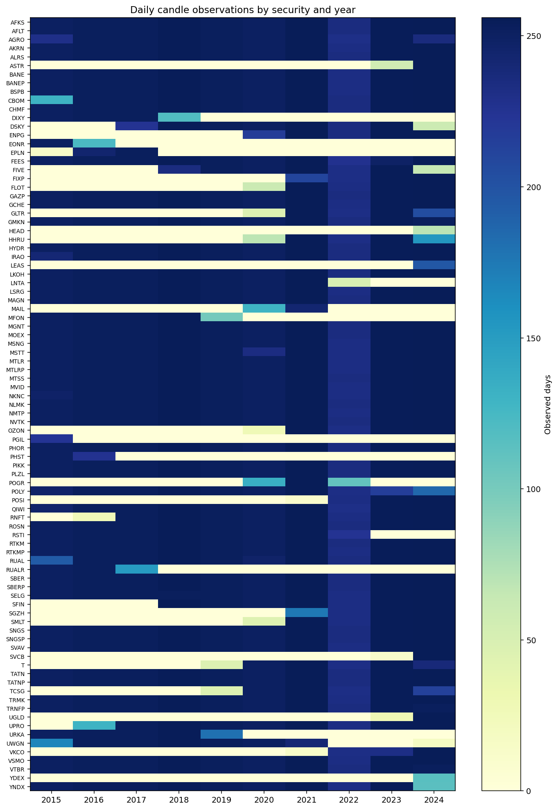
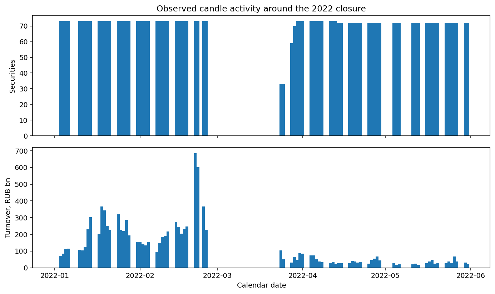
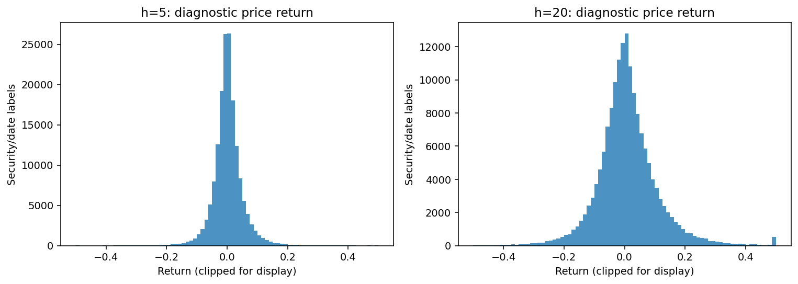
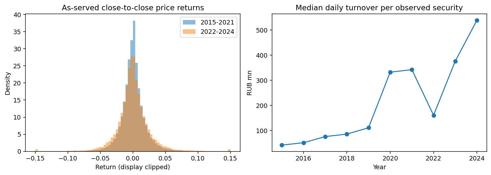
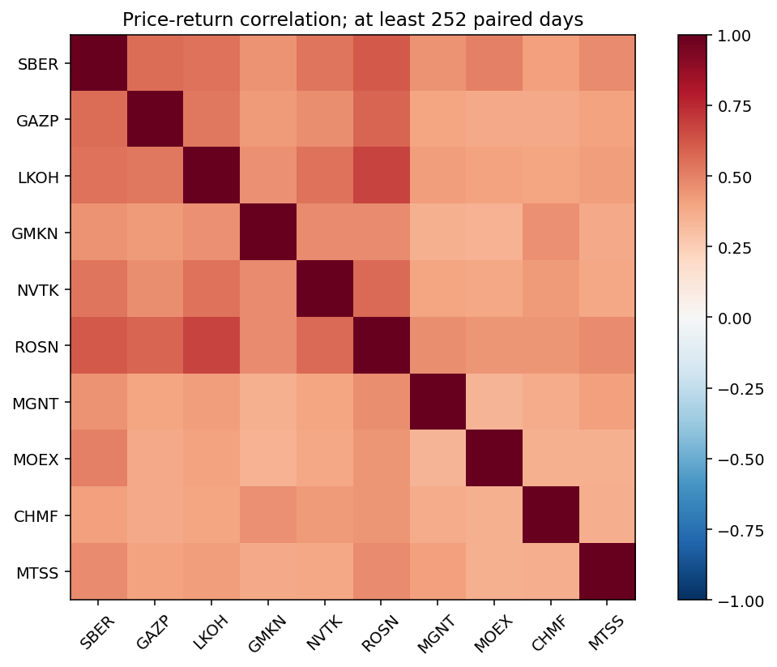
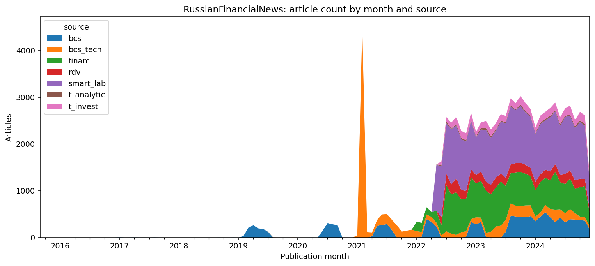
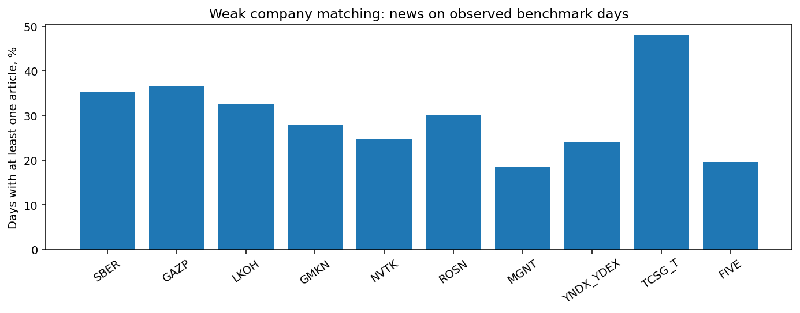
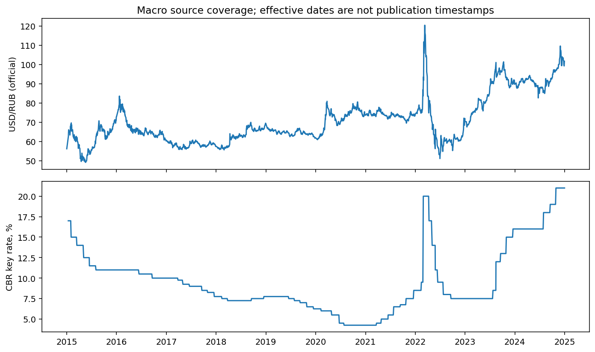

# EDA: MOEX Portfolio Copilot

Срез получен 10 ноября 2026 года. Исследовательское окно — 2015–2024; holdout 2025–2026 не использовался. Исходная точка — `hw_1`, commit `5f7d88527f46d58832363ba9de03d0beb68f4602`.

Цель анализа — проверить, позволяют ли доступные источники построить честную выборку для ранжирования акций на 5/20 сессий. Это исследование данных, а не результат обучения или бэктеста.

[Выполненный ноутбук](../../notebooks/01_eda.ipynb) · [Все численные проверки](summary.json) · [Manifest источников](sources_manifest.json) · [Дизайн-документ](../../docs/ml_system_design_doc.md)

## Состав и объём

| Данные | Строки | Покрытие | Назначение |
|---|---:|---|---|
| Дневные свечи TQBR | 166,782 | 89 кодов, 2015-01-05 — 2024-12-30 | Покрытие, OHLCV, диагностические доходности |
| Квартальные срезы IMOEX | 1 803 | 40 дат, 38–50 кодов на срез | Исследовательский список исторических кодов |
| Диагностический `/history` | 1 767 | 9 кодов за 2024 год | Сессии, отсутствие торгов, сравнение полей цен |
| MCFTR | 2 508 | 2015-01-05 — 2024-12-30 | Наблюдаемый календарь индексных дат |
| USD/RUB, ЦБ | 2 468 | 2015-01-01 — 2024-12-29 | Проверка макроисточника, номинала и дат |
| Ключевая ставка, ЦБ | 2 504 | 2015-01-12 — 2024-12-30 | Проверка макроисточника и начала покрытия |
| RussianFinancialNews | 91 477 | 2015-09-01 — 2024-12-16 | Покрытие новостей, даты, повторы, привязка к компаниям |

В кэше 679 ответов, суммарно 61,0 MB; обработанные таблицы занимают около 47,1 MB (десятичные MB). JSON ISS преобразован в таблицы с числовыми OHLC/оборотом/объёмом и датами; ЦБ — из XML/HTML; новости — из двух Parquet. Точные размеры, число столбцов и типы перечислены в `summary.json`, URL и SHA256 — в manifest. Исходные ответы и тексты не публикуются.

Набор содержит **89 кодов, а не 89 независимых инструментов**. Объединение квартальных составов не является историческим инвестиционным универсумом. Входы и выходы между срезами, даты объявления изменений и идентификаторы инструментов ещё предстоит восстановить.

## 1. Покрытие и качество цен



В свечах нет повторов `(secid, date)`, пропусков OHLCV, неположительных цен или нарушений OHLC. Но длина ряда меняется от 69 до 2 509 наблюдений; у четырёх кодов меньше 252 строк. Отсутствие null не означает полноценную историю: endpoint свечей возвращает дни с барами, а не строки для каждого ожидаемого дня.

Внутри наблюдаемых диапазонов кодов найдено 996 отсутствий на датах MCFTR. Это смесь потенциальных приостановок, особенностей режима торгов и источника; объявлять их потерей загрузки или заполнять предыдущей ценой нельзя. Ещё 33 свечи лежат вне календаря MCFTR. Следовательно, индексные даты — только временный календарь для диагностики, не подтверждённый календарь биржи.

[Покрытие каждого кода](security_coverage.csv) · [Годовые количества](annual_observations.csv) · [Даты квартальных срезов](index_snapshot_coverage.csv)

### Почему нельзя сразу обучаться на свечах

На 1 248 общих датах 2019-10-28 — 2024-11-27 отношение `close(TCSG)/close(T)` строго равно 10. Свечи `T` содержат 1 272 записи, хотя `/history/T` за 2024 год содержит только 24 строки. До сплита GMKN масштаб свечей также отличается от `/history`. Это наблюдаемое ретроспективное масштабирование, а его полные правила не установлены.

Поэтому цены здесь называются **ценами как возвращены источником**. Нельзя безоговорочно считать их нескорректированными, доступными в таком виде исторически или соответствующими старым лотам. Постоянный коэффициент сам по себе не меняет процентную доходность, но нарушает наивные предположения об идентификаторах, номинальных ценах, количестве акций и исполнении. Механическая склейка кодов неприемлема; RUALR/RUAL также перекрываются, и их отношение цен не является константой.

В `/history` есть 217 строк без `open` и 12 без `legalcloseprice`. Из 1 550 сопоставленных дат свечи и `legalcloseprice` различаются на 1 536. Причинами могут быть разные поля/сессии и корректировки; это сравнение не устанавливает их происхождение. Для сигнала на закрытии основной сессии нужно сначала подтвердить контракт полей и время публикации.

[Перекрытие кодов и отношения цен](alias_overlap.csv) · [Покрытие diagnostic history](history_security_summary.csv)

## 2. Остановка торгов и временная структура



В панели 25 февраля наблюдаются 73 кода, 28 февраля — 23 марта нет свечей, 24 марта возвращаются 33 кода, 28 марта — 59. Это фактические числа исследовательского списка, не полный реестр биржи. Одна общая дата возобновления не описывает доступность каждой бумаги.

Для диагностики меток интервалы с разрывом календаря больше семи дней помечены и исключены из обычного горизонта. Правило консервативно: оно также может затронуть длинные праздники и требует замены проверенным календарём. В будущей портфельной оценке удерживаемые позиции и переоценка через остановки сохраняются; их убыток нельзя удалить вместе с модельной меткой.

## 3. Доступность ценовых таргетов



Для каждой общей даты `t`: `open(t+1+h)/open(t+1) - 1`, `h ∈ {5,20}`. Перед сдвигами каждая бумага выровнена на календарь MCFTR. Отсутствие нужного открытия или промежуточных цен делает диагностическую метку недоступной; следующая существующая строка бумаги его не заменяет.

| Горизонт | Доступные метки | Доля полной сетки | p01 | Медиана | p99 |
|---|---:|---:|---:|---:|---:|
| 5 сессий | 165,642 | 74.21% | -13.56% | 0.02% | 15.63% |
| 20 сессий | 162,819 | 72.94% | -24.83% | 0.29% | 32.67% |

Знаменатель — все 89 × 2 508 комбинаций кода и даты, включая периоды до листинга/после выбытия. Это не доля пригодных меток в будущем PIT-универсуме и не число независимых наблюдений. Прогрев признаков на 252 сессиях ещё дополнительно сократит выборку. Перекрывающиеся 20-сессионные метки нельзя считать независимыми строками.

Полные экстремумы сохранены в [таблице](target_summary.csv). Только для графика убраны 22/65 доступных меток, затронутых однодневным скачком цены более 50%, затем 57/497 значений обрезаны по ±50% при отображении. Это визуальный фильтр, не проверенная очистка обучающего датасета. Причины движений ещё не классифицированы. Дивиденды и корпоративные события самостоятельно не восстановлены: эти метки не являются подтверждённой полной доходностью и не доказывают преимущество над MCFTR.

## 4. Режимы и зависимость инструментов



Медиана дневной волатильности, рассчитанной окном 20 сессий, меняется с 1,52% за 2015–2021 до 1,96% за 2022–2024. Медианный дневной оборот наблюдаемого кода — с 125,5 до 335,5 млн ₽. Пул кодов и длины историй различаются, ретроспективные поправки не верифицированы, а доходность через длинное закрытие исключена из этой диагностики. Поэтому это описание срезов, не доказательство смены причинного механизма или предсказуемости.



Для десяти заранее выбранных ликвидных кодов рассчитана корреляция без заполнения пропусков, при минимум 252 общих наблюдениях на пару. Общие рыночные движения требуют сравнения с простыми портфельными правилами. Разные попарные окна не дают гарантию PSD: для Ledoit–Wolf и HRP понадобится общая проверенная матрица доходностей.

[Числа по режимам](regime_summary.csv) · [Корреляции](correlation.csv) · [Число совместных наблюдений](correlation_overlap.csv)

## 5. Новости: фактическое покрытие и проблемы



В двух исходных файлах **91 955** статей. Это совпадает с суммой split-строк в метаданных карточки, но расходится с обещанными в её тексте **92 377**. Исходные даты — 2009-06-19 — 2024-12-16; после исключения 478 записей до 2015 остаётся **91 477**. Разные форматы даты (`YYYY-MM-DD` и дата со временем) разбираются явно через `format="mixed"`; непрочитанных дат нет.

Минимальная дата не означает плотную историю: за 2015–2018 всего 34 статьи; за 2022–2024 — 82 169. Последний декабрь неполный, до 16 числа. График содержит все 112 месяцев, в том числе 28 без статей, чтобы не соединять разрозненные ранние наблюдения как непрерывное покрытие. Эффект новостей нельзя оценивать на всём ценовом периоде 2015–2024 одним отсутствующим/нейтральным значением.

| Фактический источник | Статей |
|---|---:|
| smart_lab | 34 517 |
| finam | 22 433 |
| bcs | 11 946 |
| bcs_tech | 11 560 |
| rdv | 5 721 |
| t_invest | 4 498 |
| t_analytic | 802 |

RBC в файлах отсутствует, хотя он упомянут в карточке. Будущие RSS РБК/Интерфакс нельзя считать тем же распределением; даже для Финама потребуется проверка формата и покрытия.

Текстовые поля формально заполнены, однако у **74 040 статей (80,9%)** время равно `not stated`, у **17 315** tags равны `[]`. Ни timezone, ни реальный `available_at` этим корпусом не подтверждены. Нельзя автоматически присоединять такие статьи к закрытию указанного дня.

Найден **1 711** повторный нормализованный title+body; **266** семейств и **1 534** строки пересекают исходные train/test. Даты этих splits также перекрываются. Значит, готовое разбиение не подходит для финансовой временной валидации: нужны группировка повторов и собственные временные границы. Проверка охватывает только точные нормализованные повторы, не все перепечатки/парафразы.

Особенно подозрительны **4 417 статей `bcs_tech` с датой 2021-02-19** (38,2% этого источника). Это не доказанное событие рынка; до проверки происхождения таких timestamps данные следует держать вне основной PIT-ветки. Отдельных sentiment labels в схеме нет: tags не являются разметкой позитивной/нейтральной/негативной тональности.

[Месячные количества](news_monthly.csv) · [Разбиения исходного датасета](news_split_summary.csv)

## 6. Привязка к компаниям



После удаления нормализованных повторов ищутся алиасы десяти компаний в title/body/tags. У SBER есть совпадения на 35,2% наблюдаемых дат MCFTR в пересечении диапазонов, у MGNT — на 18,6%; диапазон по десяти компаниям — 18,6–48,0%. Это покрытие слабым regex, а не precision entity linking, валидная разметка тональности или доказанное наличие информации до cutoff.

В знаменатель входят и ранние годы с редкими статьями; интервалы отдельных приостановок не вычитаются из диапазона компании. Поэтому по этому показателю нельзя заключить, что сентимент бесполезен, или сравнить качество источников. Для абляции потребуется заново измерить покрытие на проверенном плотном периоде; семантическое отсутствие новости должно отличаться от отсутствия исторического источника.

[Правила и алиасы](../../src/moex_portfolio/eda.py) · [Числа и знаменатели](news_entity_coverage.csv)

## 7. Макроисточники



В курсах и ставке нет повторных дат, пропущенных чисел или неположительных значений. Для USD учтён номинал валюты. При этом ставка начинается лишь 12 января 2015: первые **четыре** даты MCFTR не имеют предыдущего значения в выгрузке. Нужен официальный seed до начала периода либо явный missing; `bfill` из будущего запрещён.

Дата действия курса/ставки не равна дате и времени публикации. График проверяет покрытие источника, а не готовность PIT-признака. Перед backward as-of join нужно подтвердить `available_at` и правила пересмотров; такой join в ДЗ-2 ещё не реализован.

## Решения по результатам EDA

1. Основной путь — ценовой бейзлайн после разрешения идентификаторов, корпоративных событий, сессий и истории membership. Качественные по формату свечи сами по себе недостаточны.
2. Ценовые метки и будущая полная доходность разделены. Для сплитов, дивидендов, приостановок и исполнения нужен отдельный проверяемый слой.
3. Новости — условная отдельная абляция на общем подтверждённом периоде. До аудита дат/времени и разметки строгая PIT-ветка не допускается; календарный минимум 2015 года не задаёт период моделирования.
4. Валидация вложенная, с purge по фактической доступности метки. Внешний test не используется для early stopping, holdout остаётся закрытым.
5. Последующие задания сначала закрывают риски данных; расширение числа моделей до этого даст мало полезной информации.

## Воспроизведение и проверка

Из корня, в окружении с `requirements-eda.txt`:

```bash
make eda          # загрузка и выполненный ноутбук
make eda-offline  # те же сохранённые ответы, без сети
make lint test
```

Ноутбук фактически выполнен через IPython в текущем процессе: в этой среде запуск отдельного Jupyter kernel ограничен. Ячейки и rich outputs сохранены в обычном `.ipynb`; файл можно открыть в Jupyter. Ошибки ячеек прерывают генерацию, выводы не подставляются вручную.

Два полных offline-повтора загрузки дали побайтно одинаковые семь Parquet, collection и manifest. Перед EDA проверяются SHA256 обработанных файлов, отпечаток конфигурации и связь с manifest источников. Для точного повторения нужно сохранить локальный raw-кэш: новый онлайн-запрос MOEX позже может вернуть пересмотренную историю; новая выгрузка не гарантирует совпадение с этой по одному URL. В публичном репозитории остаются проверяемые агрегаты и хеши, а не сырьё.

## Соответствие ДЗ-2

| Требование | Результат |
|---|---|
| EDA: состав, объём, качество, визуализации и выводы | Этот отчёт, выполненный ноутбук, CSV/JSON и восемь графиков |
| Этап 1: подготовка данных | Дизайн-документ, раздел 2.3, этап 1 |
| Этап 2: модели, loss/метрики, валидация и развитие | Дизайн-документ, раздел 2.3, этап 2 |
| Этапы, специфические для задачи | Новости/сентимент, портфель и исполнение, объяснения, ежедневный расчёт и мониторинг |

## Источники

- [MOEX ISS](https://iss.moex.com/iss/reference/): candles TQBR, history и analytics/IMOEX; точные запросы — в manifest.
- [USD/RUB, XML ЦБ](https://www.cbr.ru/scripts/XML_dynamic.asp), [ключевая ставка ЦБ](https://www.cbr.ru/hd_base/KeyRate/).
- [Закреплённая версия RussianFinancialNews](https://huggingface.co/datasets/Kasymkhan/RussianFinancialNews/tree/f83da5c05c82c9086806cf90ded4155052f9605c).
- [Шаблон ML System Design Doc](https://github.com/IrinaGoloshchapova/ml_system_design_doc_ru/blob/main/ML_System_Design_Doc_Template.md).
